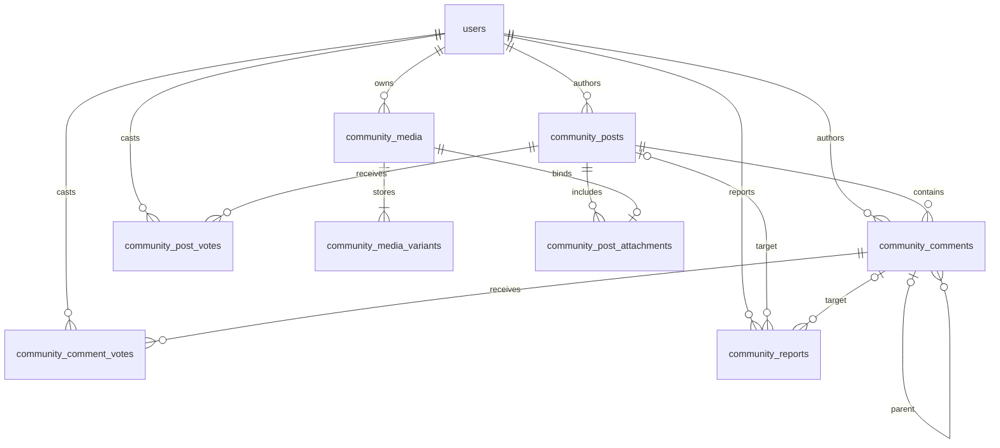

# Phase 2 Community API, schema and security
Validated locally on 15 October 2026. Scope: Community & Moderation. No notification delivery.

## Authorization

All Community endpoints require the existing active, password-completed session. Writes also use the existing CSRF token and origin checks. Suspended sessions are revoked by existing authentication.

| Action | Guest | Student | Admin without Community permission | Admin with `community:moderate` / Super Admin |
|---|---|---|---|---|
| Read feed, discussion and visible attached images | No | Yes | Yes | Yes |
| Create, comment, vote, report | No | Yes | Yes | Yes |
| Edit/delete own visible unlocked content | No | Yes | Yes | Yes |
| Read reports, hidden content and review images | No | No | No | Yes |
| Hide/remove/restore; lock/unlock; pin/unpin; resolve/dismiss | No | No | No | Yes |
| Manage student accounts | No | No | Separate existing permission | Separate existing permission |

No real accounts or permissions were changed. Ordinary admin status alone does not grant moderation.

## Member endpoints

Prefix `/api/community`.

| Method | Path | Input / result |
|---|---|---|
| GET | `/posts` | `sort=new\|top\|popular&tag=&q=&limit=20&cursor=`; `{items,pinned,tags,canModerate,nextCursor}` |
| POST | `/posts` | Post input; 201 `{post}` |
| GET | `/posts/:id` | `{post,canModerate}` |
| PATCH | `/posts/:id` | Full Post input; author only; `{post}` |
| DELETE | `/posts/:id` | Author soft-delete, 204 |
| GET | `/posts/:id/comments` | Optional `parentId,limit,cursor`; `{items,nextCursor}` |
| POST | `/posts/:id/comments` | `{body,parentId:null}`; 201 `{comment}` |
| PATCH | `/comments/:id` | `{body}`, author only |
| DELETE | `/comments/:id` | Author soft-delete, 204 |
| PUT | `/posts/:id/vote`, `/comments/:id/vote` | `{value:-1\|0\|1}`; `{score,myVote}` |
| POST | `/reports` | `{targetType:"post"\|"comment",targetId,reason}`; 201 `{id}` |
| POST | `/uploads` | Multipart, one field `image`; 201 `{image}` |
| DELETE | `/uploads/:id` | Discard own staged image, 204 |
| GET | `/media/:id`, `/media/:id/thumbnail` | Authorized private WebP stream |

Post input:
```json
{"title":"A project question","body":"Plain text content","tag":"Projects","linkUrl":"https://example.org/project","attachments":[{"id":"upload-uuid","description":"Image description"}]}
```

Title 1–180 characters; body 1–15,000; comment 1–5,000; reason 3–500; image description 0–300; up to four distinct attachments. Tags: AI, ML, Projects, Help, Events, Announcements. Link optional, HTTPS only, maximum 1,500 characters, no embedded credentials. Content is escaped plain text; external links use noopener/noreferrer. No server fetch of external links.

Author DTO contains only `{id,name,avatarUrl}`. The ID links to a protected safe profile; roll numbers, email, permissions and credentials are excluded. Current name/avatar are joined at read time. Disabled/deleted authors use a fallback without an active profile link. Admin bylines open a safe administrator profile, without including them in the student directory.

Post DTO: id, title, body, tag, linkUrl, author, createdAt, editedAt, status, isLocked, isPinned, pinnedAt, score, myVote, commentCount, canEdit, attachments. Comment DTO: id, postId, parentId, depth, status, body, author, score, myVote, createdAt, editedAt, canEdit, replyCount. Attachment DTO exposes media ID, dimensions, description and authorized stream URLs; never a disk key or public object URL.

Hidden/deleted ancestors are empty placeholders only when needed to retain visible descendants. Moderators inspect original moderated text in private queues; author-deleted text cannot be restored. Locking disallows all member changes and votes on that discussion.

New sorts newest first. Top sorts score, created time, ID descending. Popular uses Top within the last seven days. Pinned announcements (maximum three) are a separate section and do not duplicate regular results; filters apply to them too. Editing a pinned post as a non-moderator unpins it for renewed review; hiding/removing/deleting unpins it, and restoration does not silently repin.

Pages return at most 50 rows (default 20). Cursors bind to filters and parent discussion. Creation time/ID and score tie-breakers are deterministic for an unchanged dataset. Ranking can move while votes change; Refresh obtains current rankings. Search is a bounded literal substring across title/body/tag, not SQL wildcard execution. Comments use oldest-first cursor pagination and three levels total.

## Moderation endpoints

Prefix `/api/admin/community`; every route checks admin role plus Community capability.

| Method | Path | Input / result |
|---|---|---|
| GET | `/reports` | `status=open\|resolved\|dismissed\|all,limit,cursor` |
| GET | `/posts`, `/comments` | `status=hidden\|removed,limit,cursor` |
| GET | `/posts/:id` | Review detail with private review media URLs |
| POST | `/posts/:id/moderate` | `{action:"hide"\|"remove"\|"restore"\|"lock"\|"unlock",reason}` |
| POST | `/comments/:id/moderate` | `{action:"hide"\|"remove"\|"restore",reason}` |
| PUT / DELETE | `/posts/:id/pin` | `{reason}`; pin / unpin |
| POST | `/reports/:id/resolve` | `{status:"resolved"\|"dismissed",reason}` |
| GET | `/media/:id[/thumbnail]` | Private review stream, including hidden/removed posts |

Report resolution does not implicitly change visibility. Every moderation action stores actor, target, timestamp and reason in existing activity_logs. Duplicate report per reporter/target returns 409; closed reports cannot be resolved again.

## Limits and errors

Existing global IP limiter: 300 requests/minute. Per authenticated user: post/comment changes 30/minute; votes 100/minute; reports 8/10 minutes; uploads 20/10 minutes; moderator API 100/minute. Limits are process-local, matching the existing deployment architecture.

Images: JPEG/PNG/WebP only, 5 MiB each, 20 million decoded pixels, maximum input width/height 8192, static images only. Magic bytes and MIME must match; Sharp fully decodes, auto-rotates, strips metadata and re-encodes WebP. Stored image fits within 2048×2048; thumbnail within 640×640. Maximum two upload/processing slots per server process, including disconnect handling. Original bytes and supplied filenames are not published.

Staged images expire after 24 hours; cleanup runs on upload, startup and every 15 minutes (20 images per batch). Failed expired-file cleanup remains staged for retry. Per-user quota: 12 staged images / 50 MiB staged, 250 MiB stored derivatives total. Stored size counts image plus thumbnail. Four images per post gives at most 20 MiB of source uploads. Transactional ownership/reference checks prevent cross-user binding, duplicate attachment IDs, or reuse in another post. Unbound detached derivatives and soft-deleted attached derivatives remain private and count toward quota until an operator applies an approved retention policy.

Storage uses the existing local/S3 abstraction, random keys and authenticated streaming. Community data and image responses use private, no-store caching; images also use nosniff and same-origin resource policy. Never expose the upload directory as static content or configure a public S3 bucket for private objects. This run exercised local storage, not an external S3 service.

401 unauthenticated/revoked; 403 permission/ownership/CSRF/origin; 404 unavailable private content; 400 validation/image/cursor error; 409 locked, duplicate report, closed report or fourth pin; 429 rate/quota; 503 processing busy. Error payload `{error,code?}`, validation may include issues. Shared codes: COMMUNITY_ERROR, DISCUSSION_LOCKED, INVALID_COMMUNITY_IMAGE, RATE_LIMITED.

## Additive schema

007 adds community_posts, community_comments, community_post_votes, community_comment_votes and community_reports, with feed/thread/moderation indexes, unique vote/report constraints, FKs and immutable comment ancestry. A composite parent FK enforces the same post; depth is capped at 0–2.

008 adds community_media, community_media_variants and community_post_attachments. This deliberately avoids rebuilding the existing files table and its immutable purpose constraint; CMS/profile files stay unchanged while the storage implementation is reused.



Scores/counts are derived from indexed records, avoiding mutable counters that drift. Identity deletion nulls authors; votes cascade with user deletion. No existing users/profile/CMS/assessment tables are recreated.

## Phase 3 boundary

server/community-events.js emits `community.reply_created` only after comment transaction commit, and only for another recipient. Payload: id, postId, commentId, actorId, recipientId. No text/contact data is embedded. Listener failure cannot roll back an accepted reply. This is an in-process integration hook, not durable delivery; no inbox, campaign, mail, push, notification record or delivery worker exists. Phase 3 must add durable idempotent delivery, recheck recipient status and content visibility before delivery, and honor preferences. No notification was claimed to have been sent.
